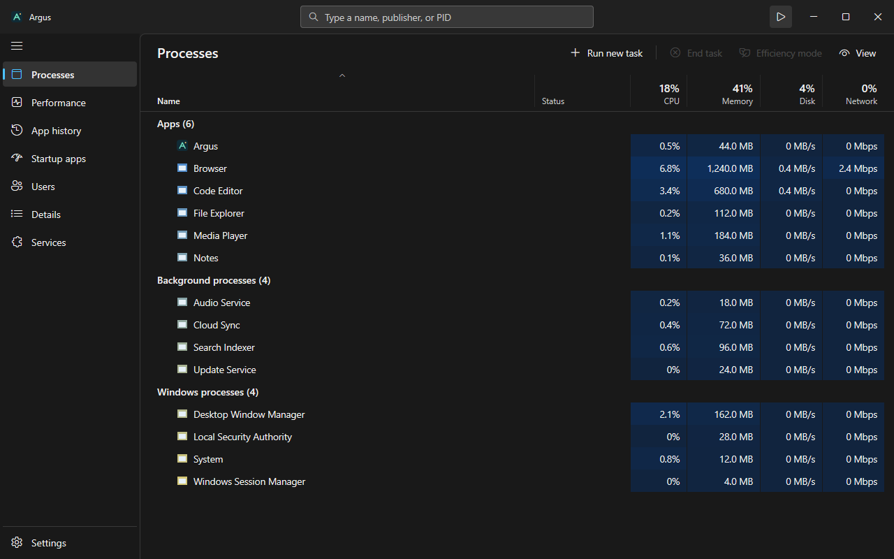
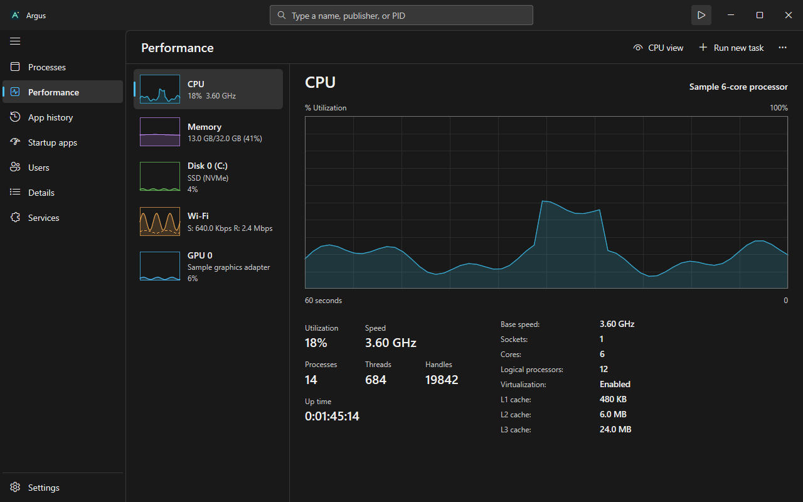
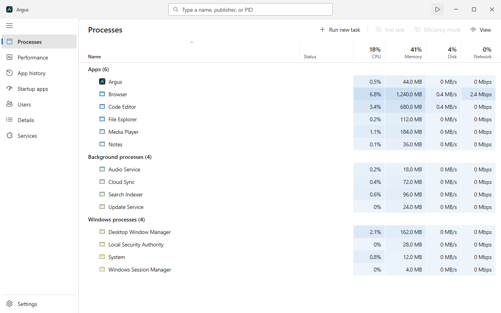

# Argus

Version 0.0.1 · [Download for Windows](https://github.com/Prit36/argus/releases/tag/v0.0.1)

A native Windows process monitor inspired by Windows 11 Task Manager,
written in Go with the [mygo](https://github.com/egoist/mygo) native UI.
Argus includes Processes (grouped
apps / background / Windows processes, heat-colored cells, column
chooser), Performance (CPU, memory, disks, network adapters and GPUs with
60-second graphs), App history, Startup apps, Users, Details, Services
and Settings, plus the tray CPU meter.

Argus is an independent project. It is not affiliated with, endorsed by,
or sponsored by Microsoft. Microsoft and Windows are trademarks of the
Microsoft group of companies.

## Screenshots

Rendered from Argus's interface using sample process and performance data.



<details>
<summary>Performance and light theme</summary>

**Performance**



**Light theme**



</details>

## Quality of life

- Clicking a Processes column sorts across Apps, Background and Windows
  processes. Use View → Group by type to show category sections again.
  Processes, Details, Services, Startup apps and App history remember their
  sort column and direction between launches.
- Search filters the current data page, including Startup apps, App history
  and Users. Each page remembers its own search during the session. Escape
  or the clear button removes the filter.
- The title-bar pause button and Ctrl+P pause/resume updates at the previous
  speed. F5 refreshes once while paused and reloads the current page's
  services, startup entries, sessions or adapter addresses as applicable.
- Ctrl+C or Copy row copies the selected process, service or startup entry
  as tab-separated text. On Performance, Ctrl+C copies the machine summary.
- Switching directly to a process's details or services clears the target
  page's filter so the selection is visible.
- Service and startup actions report progress and the Windows error when
  available. A service request being accepted does not necessarily mean the
  service has finished changing state.
- Memory dumps get unique names in the temporary folder. After creating one,
  use Processes → View → Open last dump file location, or the process menu,
  to find it.
- By default, ending apps and background processes asks for confirmation; this
  can be turned off in Settings. The dialog
  identifies grouped tasks and checks process identity before ending them.

## Build

```powershell
scripts\build.ps1          # build\windows-amd64\Argus.exe + installer
scripts\build.ps1 -Dev     # build\dev\Argus.exe, with a console for logs
scripts\build.ps1 -Test    # go vet + go test
```

Build on Windows with Go 1.27.3 or later, as specified in `go.mod`.
The mygo build tool is pinned in `go.mod`; no separate global installation
is needed. `mygo build` embeds the Argus icon, a per-monitor-DPI manifest
and version information. The build script removes local source paths
from the binaries.

Keep `LICENSE` and `THIRD_PARTY_NOTICES.txt` alongside the executable when
sharing a build. Both the development build script and production packaging
include these files. Review and update dependency notices after changing
dependencies or the Go toolchain. The app icon's editable source is
`resources/icon.svg`.

## Layout

| Package | What it holds |
|---|---|
| `internal/winapi` | The Win32/NT calls, made with `syscall.SyscallN` so steady sampling allocates nothing |
| `internal/sys` | Reading the machine: processes (one `NtQuerySystemInformation` per tick), CPU, memory, disks, network, GPU (PDH, on a worker), services, startup items, sessions, per-process network, app history, icons |
| `internal/app` | State, sampling timer, commands and the mygo views |

Every field of `App` belongs to the UI thread. Blocking work (version
resources and account names on a pool of 4 resolvers, icons on a COM STA
thread, services, sessions, startup items, PDH) runs on goroutines that
hand their results back through `Window.Update`.

Per-process network use uses an ETW trace when permitted. Otherwise it reads
Windows' native per-process network counters without elevation, provided the
Windows Network Data Usage driver is running. These counters use an
undocumented Windows interface, which may change in a future release. A dash
means Windows did not allow a process to be read; group and user totals are
also shown as unavailable if any of their processes could not be read. The
fallback establishes a baseline on its first sample, and its counts may
update with a short delay. If neither source is available, per-process network
figures are unavailable.

## Performance

Measured on an i5-12400F / RTX 5060, 1080×720 window, Processes page,
release build, steady state:

| | |
|---|---:|
| CPU (one core) | ~0.5% |
| Working set | ~44 MB |
| Private bytes | ~68 MB |
| Threads | ~21 |

- Frames take ~1–2 ms and redraw only what changed.
- The UI draws in software by default: the GPU's driver would add ~45 MB
  and two dozen threads for frames this small. `MYGO_GPU=1` draws on the
  GPU instead.
- `GOGC=50` keeps the small, long-lived heap (~8 MB live) close to what's
  in use.
- Collapsed process groups defer sorting their children until expanded.
- Startup, history and user row ordering is cached between data/filter
  changes instead of being rebuilt for mouse movement and other redraws.
- While minimized or hidden, sampling slows to at most once every four
  seconds. Restoring the window restores the chosen refresh interval;
  paused updates stay paused. GPU counters are disabled while hidden.

## Files

Settings (`settings.ini`) and app history (`history.tsv`) are kept in
`%LOCALAPPDATA%\argus`. mygo keeps the window's place in `%APPDATA%\Argus`.
After upgrading from an older build named Task Manager, window placement starts
fresh; settings and app history stay in their existing Argus directory.

Argus reads local process, hardware, service and account information. App
history is stored locally. The Search online action opens Bing in your default
browser with the selected process's name and description. Memory dumps can
contain private data; review them before sharing.

## Testing hooks

| Variable | Effect |
|---|---|
| `TASKMAN_NO_ACTIVATE=1` | Show the window without taking the focus |
| `TASKMAN_PAGE=n` | Open on page `n` (its number in settings.ini) |
| `TASKMAN_SNAPSHOTS=dir` | `go test ./internal/app` saves each tested frame there |

The `TASKMAN_` environment variable names are retained for compatibility with
existing development scripts.

## License and credits

Argus's original code, documentation and app icon are available under the
[MIT license](LICENSE). Argus was ported from the author's own earlier Zig
implementation. Third-party dependencies retain their own licenses; full
notices for the Windows application and Go runtime are included in
[THIRD_PARTY_NOTICES.txt](THIRD_PARTY_NOTICES.txt).

The interface takes inspiration from Windows 11 Task Manager. The Argus app
mark is original artwork, with its editable source in
[resources/icon.svg](resources/icon.svg). Text and command glyphs use fonts
already installed on the user's Windows system; no Windows font files are
distributed. Process icons are read from installed applications at runtime
to identify those applications. Third-party trademarks and assets remain
the property of their respective owners.
